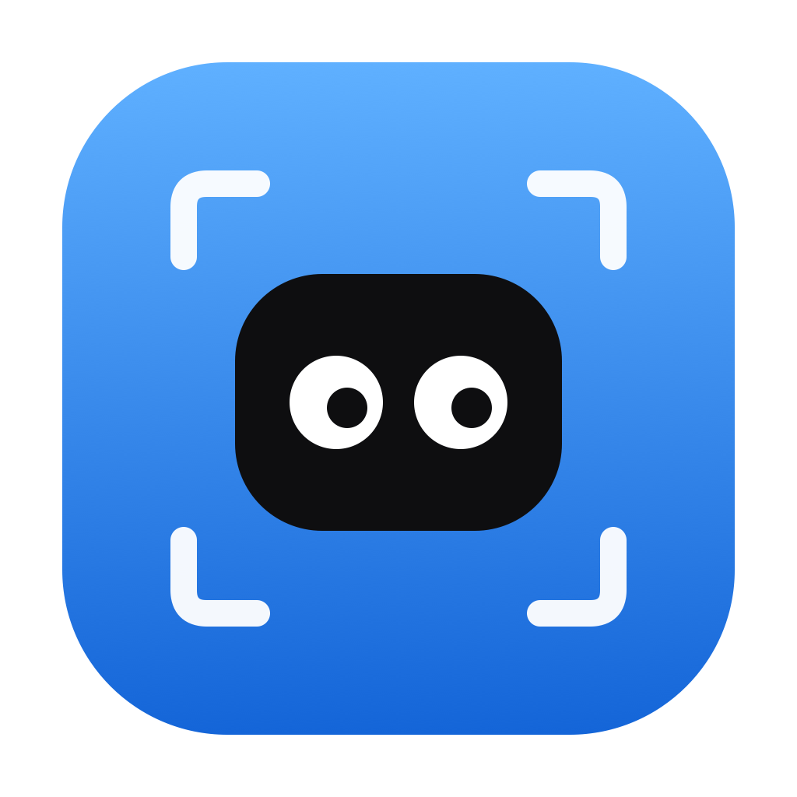

<p align="center">
  
</p>

<h1 align="center">Snappy</h1>

<p align="center">A lightweight, CleanShot-style screenshot tool for macOS. Free and open source.</p>

<p align="center"><a href="https://ndaen.github.io/snappy/">Website</a> · <a href="https://ndaen.github.io/snappy/fr/">Site en français</a> · <a href="../../releases/latest">Download</a></p>

## Features

- **Capture** an area, a window or the whole screen (global shortcuts, native macOS selection)
- **Floating overlay** after every shot: copy **without saving**, save to the desktop, annotate, pin on top, drag straight into Finder or any app
- **OCR**: select a region, its text lands in your clipboard (Apple Vision, French and English, offline)
- **Annotation editor**: arrow, rectangle, highlight, text, pixelated blur, export at the original resolution
- **Settings**: custom shortcuts, plus a "Use as default" button that replaces macOS's own capture shortcuts (⌘⇧3 / ⌘⇧4)

## Default shortcuts

| Action | Shortcut |
|---|---|
| Capture an area or a window | ⌘⇧1 |
| Capture the screen | ⌘⇧2 |
| Copy text (OCR) | ⌘⇧0 |

## Install

1. Download the DMG from the [latest release](../../releases/latest)
2. Drag `Snappy.app` into `/Applications`
3. First launch: macOS refuses the unsigned build. Open **System Settings › Privacy & Security** and click **Open Anyway**
4. Allow **Screen Recording** when macOS asks, then **relaunch the app**

## Build from source

```bash
bash scripts/build-app.sh          # build + install into /Applications
bash scripts/package.sh 0.2.0     # .app + DMG in dist/ (no install)
```

macOS 14+, Apple Silicon. The app is unsigned: after every local rebuild, re-enable Snappy in System Settings › Privacy & Security › Screen Recording.

## Licence

MIT. See [LICENSE](LICENSE).
